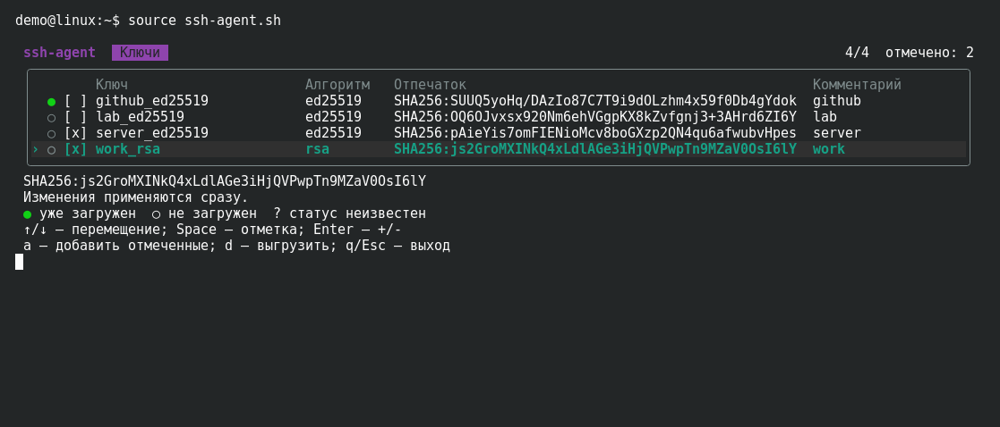
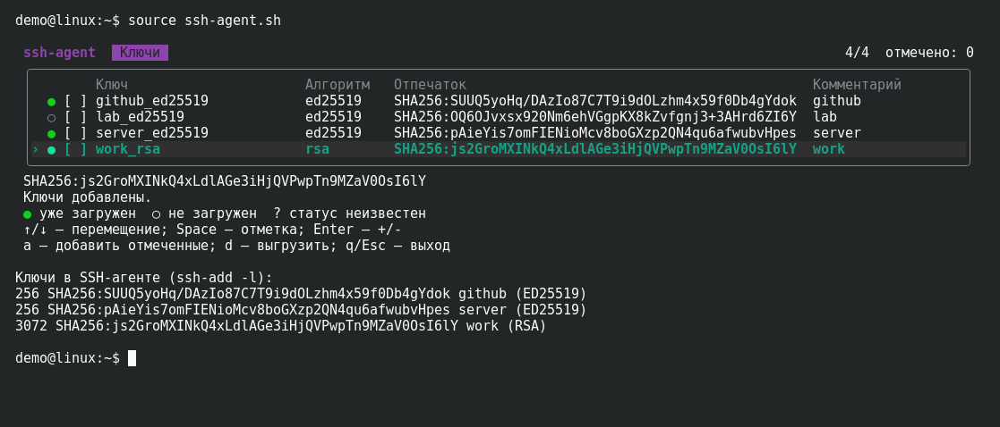

# Меню ключей SSH-агента

Bash-скрипт для загрузки и выгрузки SSH-ключей через меню в терминале.
Показывает отпечатки и уже загруженные ключи, позволяет выбрать несколько сразу.
После выхода агент остаётся доступен в том же терминале, а вывод меню — на экране.

Выбор нескольких ключей:



Результат загрузки и список ключей после выхода:



На скриншотах — Konsole и временные демонстрационные ключи.

## Быстрая установка

Нужны Bash, клиент OpenSSH и GNU coreutils. В каталоге проекта выполните:

```bash
bash install.sh --user
source "$HOME/.local/bin/ssh-agent.sh"
```

Установка выполняется в `~/.local`, без root. Если `~/.local/bin` есть в `PATH`,
далее достаточно `source ssh-agent.sh`.

**Запускайте через `source`**: это сохраняет переменные агента в текущем Bash.
Без установки можно выполнить `source ./ssh-agent.sh` из каталога проекта.

## Управление

| Клавиша | Действие |
| --- | --- |
| ↑ / ↓ или `k` / `j` | Перейти к соседнему ключу |
| Home / End | Перейти к первому / последнему ключу |
| Enter | Добавить текущий ключ; если он загружен — выгрузить |
| Space | Отметить ключ или снять отметку |
| `a` / `d` | Добавить / выгрузить отмеченные ключи |
| `q` / Esc | Выйти |

`●` — ключ уже загружен, `○` — не загружен, `?` — отпечаток недоступен.
`[x]` обозначает отметку для группового действия. Изменения применяются сразу;
после успешной операции отметки снимаются. Пароль вводится без отображения символов.

По умолчанию ключи ищутся в `~/.ssh`. Другой каталог:

```bash
source ssh-agent.sh /путь/к/ключам
```

## Подробности установки

Одинаковая схема каталогов используется в Gentoo, Debian/Ubuntu и Arch.
Установщик работает без интерактивных вопросов и не меняет настройки оболочки.

| Параметр | Назначение |
| --- | --- |
| `--user` | Установка в `~/.local` |
| `--system` | Установка в `/usr/local`, обычно через `sudo` |
| `--prefix КАТАЛОГ` | Собственный префикс установки |
| `--source КАТАЛОГ` | Исходники из другого локального клона |
| `--repo owner/repo` | Скачать исходники из указанного репозитория GitHub |
| `--ref ВЕТКА` | Ветка, тег или SHA; по умолчанию `HEAD` |
| `--uninstall` | Удалить программу |
| `--dry-run` | Показать действие и пути без изменений и скачивания |
| `--help` | Справка |

`--user`, `--system` и `--prefix` взаимоисключающие. Без них префикс — `~/.local`
для обычного пользователя и `/usr/local` для root.

```bash
sudo bash install.sh --system
bash install.sh --prefix "$HOME/tools/ssh-menu"
bash install.sh --user --dry-run
```

В `ПРЕФИКС/bin` устанавливаются `ssh-agent.sh` и `ssh-agent-setup` — копия
установщика для переустановки и удаления без исходного клона. Основной скрипт
и `lib/` находятся в `ПРЕФИКС/libexec/ssh-agent-select/`.
Если `ПРЕФИКС/bin` отсутствует в `PATH`, установщик покажет команду его добавления.

### Установка с GitHub

После публикации файлов в публичном репозитории можно скачать только установщик:

```bash
curl -fsSL https://raw.githubusercontent.com/WhiteK0T/ssh-agent/HEAD/install.sh -o install.sh &&
    bash install.sh --user
```

Если исходников рядом нет, установщик скачает архив через `curl` или `wget`;
для распаковки нужен `tar`. Локальная установка работает без сети и Git.
Можно выбрать другую версию:

```bash
bash install.sh --user --repo WhiteK0T/ssh-agent --ref master
```

`--repo` принимает также URL GitHub и `git@github.com:owner/repo.git`, но загрузка
всегда идёт по публичному HTTPS. Для закрытого репозитория используйте локальный
клон и `--source`. Для установки конкретной версии задайте SHA в `--ref`.

### Обновление и удаление

Для обновления повторите установку из новых исходников с тем же префиксом.
`ssh-agent-setup` без параметров переустанавливает имеющиеся файлы.
Старые имена команд `ssh-agent-select` и `ssh-agent-select-setup` заменяются новыми.

```bash
ssh-agent-setup --uninstall
# Если каталог bin отсутствует в PATH:
bash install.sh --uninstall --user
# Для системной установки:
sudo /usr/local/bin/ssh-agent-setup --uninstall
```

Установленный `ssh-agent-setup` определяет свой префикс автоматически.
При удалении через `install.sh` укажите тот же `--user`, `--system` или `--prefix`,
что при установке. SSH-ключи, работающие агенты и дополнительные файлы сохраняются.
Посторонние файлы с совпавшими именами установщик не заменяет.

## Поведение и ограничения

- Доступный агент используется повторно. Новый запускается только при добавлении
  ключа; при выходе выводится `ssh-add -l`.
- Ключи ищутся непосредственно в указанном каталоге, включая скрытые файлы и ссылки.
  Для старых зашифрованных PEM-ключей может понадобиться соответствующий `.pub`.
- Полный отпечаток текущего ключа показан под таблицей. Колонки подстраиваются
  под ширину окна; в очень узком терминале и при перенаправлении вывода меню
  печатается последовательными блоками. Изменение размера окна начинает новый блок.
- Для ввода пароля используется OpenSSH с поддержкой `SSH_ASKPASS_REQUIRE=force`.
  Ошибка операции не закрывает меню, но при выходе возвращается код 1.
- Выгрузка ключа не запрещает другим приложениям читать его через `IdentityFile`.
  `AddKeysToAgent` в SSH-конфиге может загрузить его снова; `no` отключает
  автодобавление, но не запросы пароля при подключении.

## Разработка и проверки

`ssh-agent.sh` — точка входа, `lib/` — работа с агентом, ключами и меню,
`tests/` — тесты Bats. Скриншоты находятся в `docs/screenshots/`. Сборка не нужна.

```bash
bats tests
SSH_AGENT_TEST_MODE=mock bats tests
shellcheck -x install.sh ssh-agent.sh lib/*.bash lib/askpass.sh tests/test_helper.bash tests/*.bats
```

Тесты используют временные ключи и собственные агенты. Режим `mock` работает
без Unix-сокетов. Для проверок терминала нужен Python 3, иначе они пропускаются.
